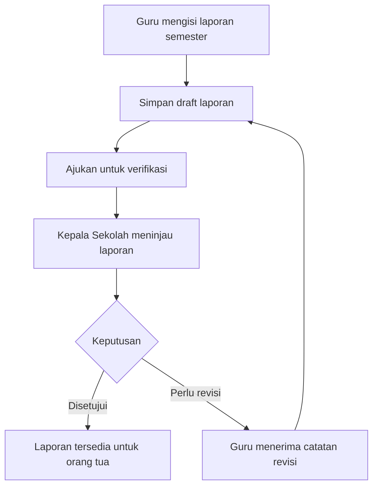

<div align="center">
  
  

  <h1>DIGIT — Monitoring Perkembangan Anak</h1>
  <p><strong>Website Monitoring Perkembangan dan Portofolio Murid TK Telkom Mojokerto</strong></p>
  <p>
    
    
    
    
  </p>
  <p><em>Pantau tumbuh kembang anak, satu tempat.</em></p>
</div>

---

## Tentang DIGIT ℹ️

**DIGIT** adalah aplikasi web untuk membantu proses pemantauan perkembangan dan portofolio murid TK Telkom Mojokerto. Aplikasi ini dirancang sebagai ruang terpusat bagi guru, orang tua, admin, dan kepala sekolah untuk mengelola serta melihat informasi perkembangan anak.

Melalui DIGIT, guru dapat mencatat perkembangan dan kehadiran, mendokumentasikan kegiatan serta hasil karya, kemudian menyusun laporan perkembangan semester. Kepala sekolah dapat meninjau dan memberikan keputusan terhadap laporan sebelum laporan tersebut dapat dilihat oleh orang tua.

> DIGIT dikembangkan dengan pendekatan *role-based access*, sehingga menu dan data yang ditampilkan menyesuaikan peran pengguna.

## Tujuan pengembangan

- Mempermudah pencatatan perkembangan anak secara terstruktur.
- Menghubungkan informasi sekolah dengan orang tua melalui akses laporan anak.
- Mendokumentasikan kegiatan pembelajaran dan hasil karya murid.
- Mendukung proses verifikasi laporan oleh kepala sekolah.
- Menyediakan rekap data untuk kebutuhan pemantauan dan pelaporan sekolah.

## Peran pengguna

| Peran | Tanggung jawab dan akses utama |
|---|---|
| **Admin** | Mengelola akun pengguna, memproses pendaftaran akun, serta mengelola data induk siswa. |
| **Guru** | Memilih kelas yang diajar, mengelola data siswa, mencatat perkembangan, mengisi absensi, mengelola kegiatan dan portofolio, serta menyusun laporan semester. |
| **Orang Tua** | Melihat identitas anak, perkembangan yang telah disetujui, absensi, portofolio yang telah disetujui, dan laporan semester anak. |
| **Kepala Sekolah** | Memantau data sekolah, memverifikasi catatan perkembangan dan portofolio, meninjau laporan semester, serta membuat laporan umum. |

## Fitur yang sudah tersedia pada prototype

### 1. Login dan manajemen akun
- Login menggunakan username atau email.
- Pendaftaran akun baru.
- Pengalihan dashboard berdasarkan peran pengguna.
- Pengelolaan status akun: menunggu, aktif, nonaktif, dan ditolak.
- Pengaitan akun orang tua dengan data anak menggunakan NIS dan tanggal lahir pada proses pendaftaran.

### 2. Dashboard berdasarkan peran
- Dashboard terpisah untuk Admin, Guru, Orang Tua, dan Kepala Sekolah.
- Ringkasan statistik sesuai kebutuhan masing-masing peran.
- Visualisasi ringkas data kehadiran dan catatan perkembangan.
- Kartu identitas anak pada dashboard orang tua.

### 3. Data siswa
- Menampilkan daftar siswa.
- Menambahkan, mengubah, dan menghapus data siswa sesuai hak akses.
- Mengelola informasi NIS, nama, tanggal lahir, jenis kelamin, kelas, status, dan foto.
- Menghubungkan data siswa dengan akun orang tua.

### 4. Monitoring perkembangan anak
- Mencatat tanggal, siswa, aspek perkembangan, dan deskripsi pengamatan.
- Menggunakan tujuh aspek perkembangan:
  1. Agama dan Moral
  2. Kognitif
  3. Bahasa
  4. Motorik Kasar
  5. Motorik Halus
  6. Sosial-Emosional
  7. Seni
- Mendukung status verifikasi: menunggu, disetujui, dan perlu revisi.
- Orang tua hanya dapat melihat catatan perkembangan yang telah disetujui.

### 5. Absensi
- Pencatatan kehadiran harian siswa.
- Status kehadiran: Hadir, Izin, Sakit, dan Alpha.
- Riwayat dan ringkasan absensi.

### 6. Kegiatan dan portofolio
- Pengelolaan kegiatan pembelajaran.
- Dokumentasi hasil karya melalui unggahan gambar.
- Portofolio dapat dikaitkan dengan siswa atau kelas dan kegiatan.
- Mendukung proses verifikasi sebelum portofolio ditampilkan kepada orang tua.

### 7. Laporan perkembangan akhir semester
- Guru mengisi penilaian setiap siswa untuk tujuh aspek perkembangan.
- Skor indikator menggunakan rentang **1–10**.
- Laporan memuat ringkasan data perkembangan, kehadiran, dan portofolio.
- Grafik menampilkan skala nilai pada sumbu vertikal dan nama indikator pada sumbu horizontal.
- Guru dapat menyimpan draft dan mengajukan laporan untuk ditinjau kepala sekolah.
- Kepala sekolah dapat menyetujui laporan atau meminta revisi dengan catatan.
- Orang tua dapat melihat laporan yang telah disetujui.
- Laporan dapat dicetak atau disimpan sebagai PDF melalui fitur cetak browser.

### 8. Laporan umum sekolah
- Menyediakan ringkasan data dan laporan berdasarkan jenis data.
- Mendukung filter rentang tanggal.
- Mencakup data siswa, perkembangan, absensi, kegiatan, dan portofolio.
- Hasil laporan dapat dicetak melalui browser.

## Alur verifikasi laporan semester



## Teknologi yang digunakan

| Teknologi | Penggunaan |
|---|---|
| **HTML5** | Struktur halaman dan komponen aplikasi. |
| **CSS3** | Styling, layout responsif, komponen, dan identitas visual DIGIT. |
| **JavaScript (Vanilla)** | Interaksi antarmuka, validasi form, pengelolaan data, autentikasi prototype, dan visualisasi laporan. |
| **Browser Local Storage** | Penyimpanan data sementara pada browser selama tahap prototype. |

**Catatan arsitektur:** paket project saat ini merupakan prototype frontend statis. File yang tersedia menggunakan HTML, CSS, dan JavaScript serta menyimpan data melalui `localStorage`. Integrasi backend PHP, database MySQL, API, dan autentikasi sisi server belum termasuk dalam paket ini.

## Tampilan dan identitas visual

DIGIT menggunakan identitas visual yang terinspirasi dari warna Telkom: gradasi merah sebagai aksen utama, merah marun untuk penekanan, serta permukaan putih dan abu-abu hangat agar tampilan tetap nyaman dibaca.

Antarmuka dirancang untuk digunakan melalui desktop maupun layar yang lebih kecil, dengan penyesuaian layout pada komponen navigasi, kartu, tabel, dan formulir.

## Menjalankan project

Project tidak memerlukan proses build atau instalasi package tambahan untuk mencoba prototype.

1. Download atau clone repository.
2. Ekstrak project jika menggunakan file ZIP.
3. Buka folder `DIGIT PROGRESS`.
4. Jalankan `index.html` melalui browser. Disarankan menggunakan extension **Live Server** pada Visual Studio Code untuk menjalankan project melalui server lokal.
5. Masuk menggunakan salah satu akun demo pada tabel di bawah.

### Akun demo

| Peran | Username | Password |
|---|---|---|
| Admin | `admin` | `admin123` |
| Guru | `guru` | `guru123` |
| Orang Tua | `ortu` | `ortu123` |
| Kepala Sekolah | `kepsek` | `kepsek123` |

**Catatan pengujian:**
- Pada dashboard Guru, pilih kelas yang akan dikelola sebelum mencoba fitur pencatatan siswa.
- Akun demo Orang Tua telah terhubung dengan data anak contoh.
- Data prototype tersimpan pada browser yang digunakan. Data tidak otomatis tersinkronisasi ke browser atau perangkat lain.
- Menghapus data situs atau `localStorage` browser dapat menghapus data uji dan mengembalikan data awal demo.
- Akun di atas hanya untuk demonstrasi lokal. Jangan gunakan kredensial demo untuk layanan publik atau data siswa sebenarnya.

## Struktur project

```text
DIGIT PROGRESS/
├── assets/
│   ├── favicon.png
│   ├── logo-placeholder.svg
│   └── logo.png
├── css/
│   └── style.css
├── js/
│   ├── absensi.js
│   ├── akun.js
│   ├── dashboard.js
│   ├── data.js
│   ├── kegiatan.js
│   ├── laporan-siswa.js
│   ├── laporan.js
│   ├── login.js
│   ├── perkembangan.js
│   ├── portofolio.js
│   ├── register.js
│   ├── report-card.js
│   ├── sandi.js
│   ├── siswa.js
│   ├── ui.js
│   └── verifikasi-laporan.js
├── absensi.html
├── daftar.html
├── dashboard-admin.html
├── dashboard-guru.html
├── dashboard-kepsek.html
├── dashboard-ortu.html
├── data-siswa.html
├── index.html
├── kegiatan.html
├── kelola-akun.html
├── laporan-guru.html
├── laporan-ortu.html
├── laporan.html
├── perkembangan.html
├── portofolio.html
├── ubah-sandi.html
├── verifikasi-laporan.html
└── README.md
```

## Progress pengembangan

| Area | Progress pada prototype |
|---|---|
| Antarmuka login dan registrasi | Tersedia |
| Dashboard empat role | Tersedia |
| Pengelolaan akun dan siswa | Tersedia |
| Pencatatan perkembangan dan absensi | Tersedia |
| Kegiatan dan portofolio | Tersedia |
| Laporan semester dan alur verifikasi | Tersedia |
| Laporan umum dan cetak | Tersedia |
| Backend PHP dan database MySQL | Belum diintegrasikan |
| Autentikasi dan otorisasi server-side | Belum diintegrasikan |
| Penyimpanan file terpusat dan deployment produksi | Belum diintegrasikan |

## Rencana pengembangan berikutnya

- [ ] Merancang dan mengintegrasikan backend PHP.
- [ ] Menghubungkan aplikasi ke database MySQL berdasarkan rancangan ERD.
- [ ] Memindahkan proses autentikasi dan validasi hak akses ke sisi server.
- [ ] Menambahkan penyimpanan file/foto pada server.
- [ ] Melakukan pengujian fungsional untuk setiap role dan alur verifikasi.
- [ ] Menyiapkan deployment dan konfigurasi keamanan untuk penggunaan sekolah.

## Status dan batasan prototype

DIGIT saat ini berada pada tahap **prototype frontend interaktif** untuk pengembangan dan pengujian alur aplikasi. `localStorage` dan mekanisme login di JavaScript digunakan untuk simulasi, bukan sebagai sistem keamanan produksi. Karena itu, prototype belum ditujukan untuk menyimpan data pribadi murid sebenarnya atau digunakan sebagai layanan operasional sekolah.

Sebelum digunakan secara nyata, aplikasi perlu dilengkapi backend, database terpusat, autentikasi aman, kontrol akses sisi server, validasi unggahan, pencadangan, dan pengujian keamanan.

---

<div align="center">
  <strong>DIGIT · TK Telkom Mojokerto</strong><br />
  <sub>Monitoring perkembangan dan portofolio murid dalam satu tempat.</sub>
</div>
